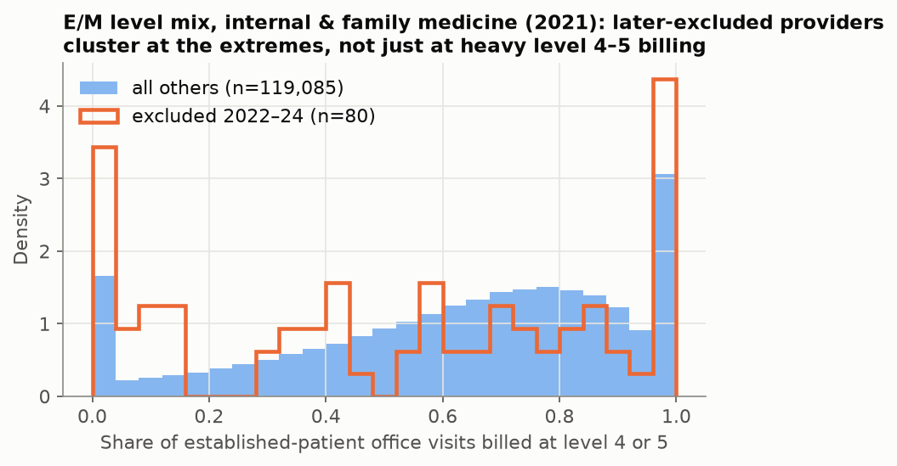
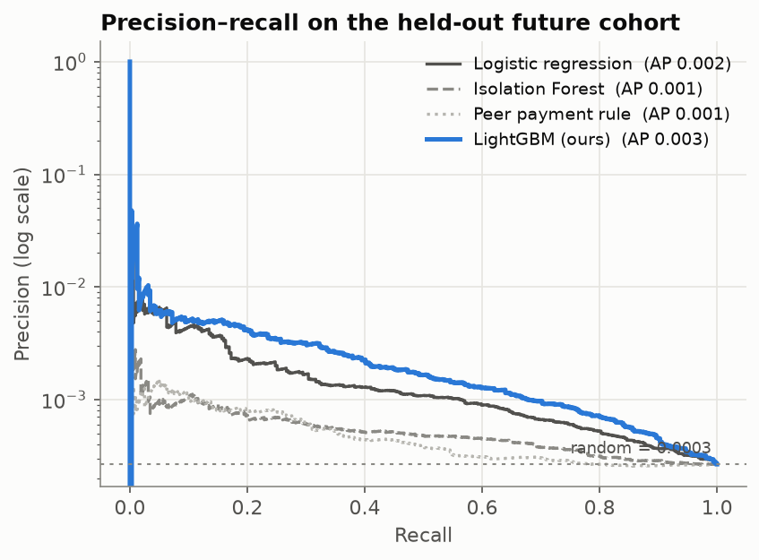
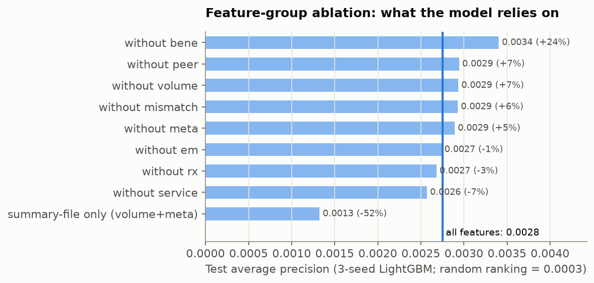
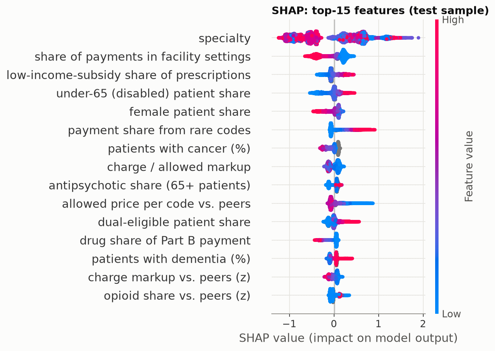
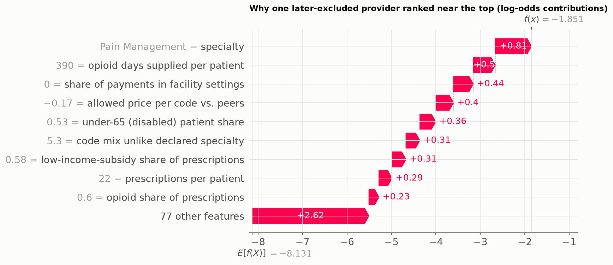
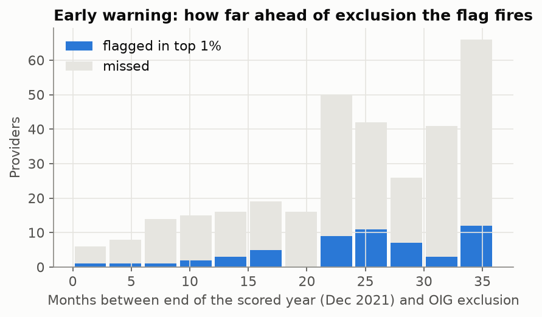
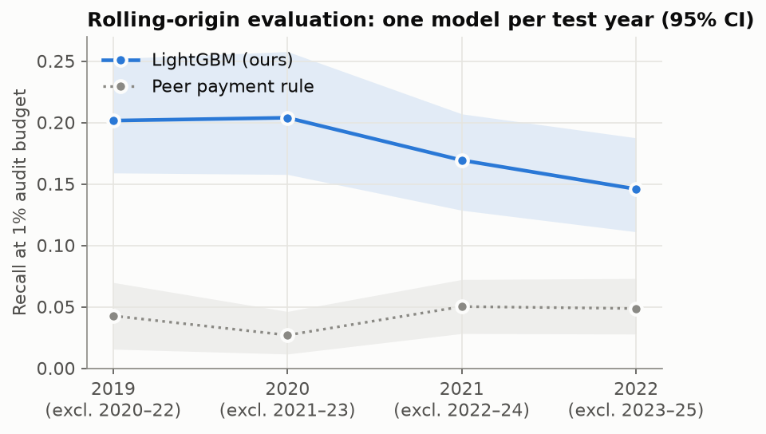
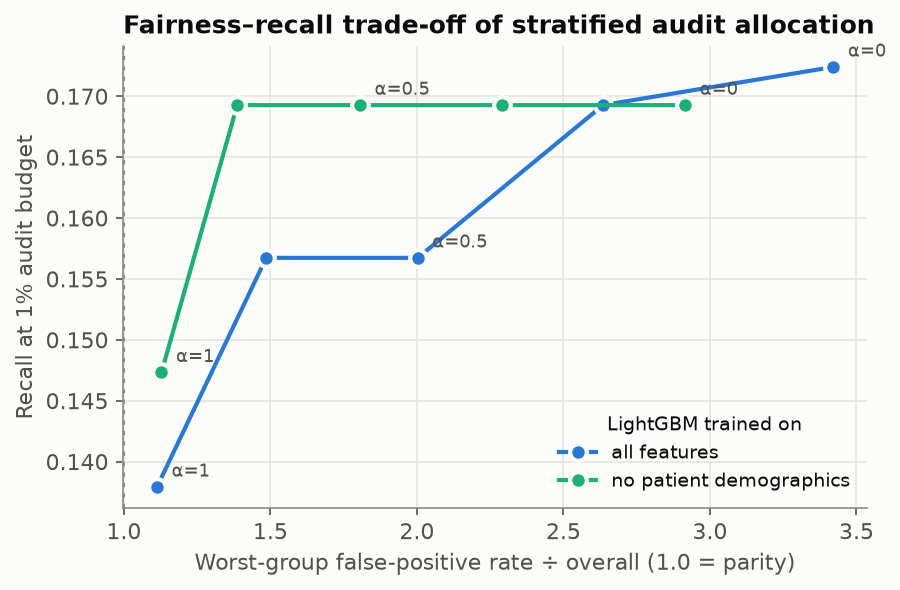

# Forecasting Medicare Fraud Exclusions from Public Billing Data

[](https://github.com/benyahuta/medicare-fraud-forecasting/actions/workflows/ci.yml)
**[Interactive results →](https://benyahuta.github.io/medicare-fraud-forecasting/)** · [Model card](MODEL_CARD.md) · [Full results tables](reports/RESULTS.md)

Improper payments in Medicare fee-for-service run to tens of billions of dollars a year, while the HHS Office
of Inspector General (OIG) can investigate only a sliver of the ~1.2 million clinicians who bill it. This project
asks a concrete question: **using only data CMS already publishes, can we tell investigators which providers to
look at first, and who would those leads unfairly land on?**

The model reads one year of a provider's public Medicare billing (Part B services and Part D prescribing) and ranks
how likely they are to be **excluded by OIG for fraud, abuse or misconduct within the next three years**. Everything is
evaluated strictly forward in time: the model is trained on exclusions through 2021 and tested on what OIG actually did in
2022–2024.

<p align="center"></p>

## Headline results (2021 billing → exclusions in 2022–24)

Held-out test cohort: **1,198,748 providers**, of whom **319** were excluded in 2022–24 (0.027%). 95% stratified-bootstrap CIs.

| | LightGBM (ours) | Logistic regression | Peer-payment rule¹ | Isolation Forest |
|---|---|---|---|---|
| **Recall when reviewing the top 1%** | **17.2%** (13.3–21.3) | 14.1% | 5.0% | 3.4% |
| Lift over random at 1% | **17×** | 14× | 5× | 3× |
| ROC-AUC | **0.823** (0.800–0.850) | 0.776 | 0.582 | 0.644 |
| Average precision (random = 0.0003) | **0.0028** | 0.0018 | 0.0005 | 0.0006 |

¹ *Rank providers by payment-per-patient z-score within their specialty, i.e. what a spreadsheet audit does.*

* **3.4× more cases than the peer-payment rule** for the same review effort. In a paired bootstrap LightGBM beats both unsupervised
  baselines in all 300 replicates, and logistic regression in 95% of them.
* **Early warning.** Providers caught in the top 1% were excluded a median **26 months** after the end of the billing year scored.
* **Money.** Re-ranking by *risk × Medicare dollars* finds the providers holding **59%** of payments to later-excluded
  providers at a 1% budget (88% if the two largest labs are counted), versus 35% when ranking by dollars alone.
* **Fairness.** The raw model wrongly flags providers who serve many low-income (dual-eligible) or disabled patients at
  **3.4×** the average rate. **Dropping patient demographics and stratifying the audit queue by patient mix cuts that to
  1.4× with no loss of recall on the test cohort** (16.9% vs 17.2%).

## What's in here

| | |
|---|---|
| **Data engineering** | ~25 GB of raw CMS files → 4.5M labelled provider-years, ~70M billing lines (Polars, Parquet cache) |
| **Feature engineering** | 86 features in 8 groups, all computed *within year* against specialty peers so they survive coding changes such as the 2021 E/M overhaul |
| **Models** | peer-payment rule, Isolation Forest, logistic regression, tuned LightGBM (5-seed bag), a **ClaimSet Transformer** over raw billing lines (PyTorch / Apple MPS), and a hybrid using its self-supervised embeddings |
| **Evaluation** | forward-in-time split, stratified-bootstrap CIs, paired significance tests, audit-budget metrics, dollar impact, lead time, rolling-origin test years 2019–2022 |
| **Responsible ML** | fairness audit of false positives by patient population and rurality, a stratified-allocation mitigation with its measured cost, a model card, no per-provider scores published |
| **Engineering** | installable package (`src/fraudml`), unit tests on synthetic data, ruff, GitHub Actions CI, Makefile-driven reproduction |

## Data

| Source | What it gives | Rows |
|---|---|---|
| [CMS Medicare Physician & Other Practitioners — by Provider](https://data.cms.gov/provider-summary-by-type-of-service/medicare-physician-other-practitioners/medicare-physician-other-practitioners-by-provider) | volume, payments, patient demographics & chronic conditions | ~1.1M / year |
| [… — by Provider and Service](https://data.cms.gov/provider-summary-by-type-of-service/medicare-physician-other-practitioners/medicare-physician-other-practitioners-by-provider-and-service) | every (provider, HCPCS code, place of service) line | ~10M / year |
| [Medicare Part D Prescribers — by Provider](https://data.cms.gov/provider-summary-by-type-of-service/medicare-part-d-prescribers/medicare-part-d-prescribers-by-provider) | prescribing incl. opioids, brand share, cost | ~1.1M / year |
| [OIG List of Excluded Individuals/Entities (LEIE)](https://oig.hhs.gov/exclusions/exclusions_list.asp) | who was excluded, when, under which authority | 84k |

**Label.** A provider-year is positive if the NPI appears in the LEIE under a fraud, abuse or misconduct authority
(§1128(a)(1)–(4), §1128(b)(1)–(8), §1128A) with an exclusion date in the three calendar years after the
feature year. Providers already excluded are dropped. See the [model card](MODEL_CARD.md) for why
*exclusion ≠ fraud*.

**Split.**

| Cohort | Feature year | Label window | Providers | Positives |
|---|---|---|---|---|
| train | 2016 | 2017–2019 | 1,053,934 | 309 |
| train | 2017 | 2018–2020 | 1,088,666 | 261 |
| valid | 2019 | 2020–2021 (2 yr) | 1,155,862 | 105 |
| **test** | **2021** | **2022–2024** | **1,198,748** | **319** |

All training labels close before the first test label (2022), so the final model can be refit on train + valid
without seeing the future.

## Features

All peer comparisons are within *(year, specialty)*, using robust z-scores (median / MAD) or percentiles.

| Group | Examples | Why |
|---|---|---|
| volume | payment per patient, services per patient, charge ÷ allowed markup | raw billing intensity |
| bene | % dual-eligible, % under 65, risk score, chronic-condition prevalence | case-mix context |
| peer | each volume metric as a z-score vs. same-specialty peers | "unusual for a cardiologist", not "large" |
| service | per-code services-per-patient vs. specialty median (payment-weighted), rare-code share, payment HHI | billing many more units of a code than peers |
| em | share of office visits billed at level 4–5, mean E/M level, both vs. peers | classic **upcoding** signal |
| mismatch | out-of-fold surprise −log p(declared specialty ∣ code mix) from a TF-IDF→SVD→multinomial model | a "dermatologist" billing like a lab |
| rx | opioid share, long-acting opioids, opioid days per patient, brand share, cost per claim (Part D) | pill-mill and kickback patterns |
| meta | specialty, organization vs. individual, rurality | |

<p align="center"></p>

## Results

<p align="center"></p>

Full tables, including per-specialty results and significance tests, are in [`reports/RESULTS.md`](reports/RESULTS.md).

**Model selection matters more than model choice here.** My first pass tuned LightGBM on the single 2019 validation
cohort, with 105 positives. Validation AP swung from 0.002 to 0.033 between configurations, the "best" one was noise, and on
test it did *worse* than logistic regression (recall@1% 12.2% vs 14.1%). Switching to **provider-grouped 3-fold CV on
the training cohorts** (570 positives, every configuration scored on three disjoint sets of providers) plus **balanced bagging** (each of five
members sees all positives and a different 25% of negatives) picked a heavily regularized model: extremely randomized
trees, 7 leaves, at least 2,000 samples per leaf. It wins on every metric. The change is in the
git history (`Grouped-CV model selection, balanced bagging …`).

| Budget (share of providers reviewed) | 0.1% | 0.5% | 1% | 5% |
|---|---|---|---|---|
| Providers reviewed | 1,199 | 5,994 | 11,987 | 59,937 |
| Later-excluded providers found | 11 | 30 | 55 | 128 |
| Precision | 0.9% | 0.5% | 0.46% | 0.21% |

A 0.5–1% hit rate sounds low, but the base rate is 0.027%. And "not excluded within 3 years" is not the same as
"not committing fraud", so some of the remaining flags are probably undetected cases rather than false alarms.

### What drives the score

<p align="center"><br></p>

* The engineered features **roughly double** average precision over the CMS summary file alone (0.0028 vs 0.0013).
* No single group is indispensable. Billing behaviour shows up redundantly across per-code intensity, Part D prescribing
  and E/M mix, and removing any one costs at most 7%.
* **Removing the patient-mix group did not hurt, and test AP even rose (0.0034 vs 0.0028).** With 319 test positives
  that gap is within bootstrap noise, but it points the same way as the fairness results below: patient-mix features add
  little forward-looking signal and most of the disparity.
* SHAP shows what the model keys on: specialty, office-only practices (low facility share), a high share of prescriptions
  to low-income-subsidy patients, payments concentrated in codes that peers rarely bill, *below*-peer allowed prices per
  code, and opioid prescribing above peers.
* The E/M chart above is a useful negative result. The textbook upcoding signal, "bills level 4–5 visits more than peers",
  is weak on its own: later-excluded internists and family physicians cluster at *both* extremes of the level mix.

An anonymized example (values rounded so the public files can't be searched for an exact match):

<p align="center"></p>

### Early warning

<p align="center"></p>

Most exclusions come 2–3 years after the billing year scored. The flags fire well before OIG acts: median 26 months,
IQR 22–32 months. That is long enough for a payment review or a targeted audit to matter.

### Does it hold up across years?

<p align="center"></p>

Each test year *T* gets its own model, trained only on cohorts whose three-year label windows close by the end of *T*,
before any exclusion it is scored on. This mimics an analyst retraining every January. Hyper-parameters are frozen
from the main experiment, which selected them on the 2016–17 cohorts. For test years 2019–20 that choice saw
exclusions from overlapping years, so those two rows are slightly optimistic.

| Test year | Trained on | Positives | ROC-AUC | Recall @1% | Peer-rule recall @1% |
|---|---|---|---|---|---|
| 2019 | 2016 | 258 | 0.818 | 20.2% | 4.3% |
| 2020 | 2016–17 | 260 | 0.825 | 20.4% | 2.7% |
| 2021 | 2016–18 | 319 | 0.825 | 16.9% | 5.0% |
| 2022 | 2016–19 | 288 | 0.821 | 14.6% | 4.9% |

Ranking quality (AUC) is essentially constant across four years, through COVID-19 and the 2021 E/M coding overhaul.
Top-of-list recall drifts down slightly in later years, which is worth monitoring if this were deployed.

### Can a neural network learn this from raw billing lines?

The **ClaimSet Transformer** (`src/fraudml/deep.py`) treats each provider-year as an unordered set of up to 32 billing
lines: HCPCS embedding, place of service, and 9 numeric features such as volume, price, and intensity vs. peers. A
transformer encoder with attention pooling feeds two heads. One predicts exclusion; an auxiliary head predicts the
provider's specialty from the code mix alone, which gives the encoder ~1M labels per year instead of a few hundred
positives.

| Model (2021 test cohort) | AP | ROC-AUC | Recall @1% |
|---|---|---|---|
| ClaimSet Transformer, end-to-end | 0.0010 | 0.718 | – |
| LightGBM, engineered features (3 seeds) | 0.0027 | 0.824 | 17.9% |
| LightGBM + 16 self-supervised ClaimSet embedding dims + specialty surprise | 0.0028 | 0.822 | 16.3% |

* **End-to-end training loses badly.** With ~700 positive examples the network memorizes the positives within a few
  epochs: training loss keeps falling while validation AP stays flat. Heavy regularization (2 layers, d = 64, dropout
  0.3, three positive repeats per epoch) helped but did not close the gap.
* **Self-supervised pretraining works as representation learning, but adds nothing here.** Trained only on the specialty
  task over 3.3M provider-years, the encoder recovers the declared specialty with p > 0.5 for 54% of 2021 providers across
  80 classes. Adding its embeddings to LightGBM changes AP by **+0.0002 (95% CI −0.0001 to +0.0010)**, which is not
  significant.
* **Takeaway:** with labels this scarce, domain-specific peer-relative features carry the signal that a sequence model
  would otherwise have to discover from a few hundred examples. I'd expect the neural approach to pay off with
  claim-level data or far more positives (e.g. state Medicaid fraud-unit referrals).

## Who gets wrongly flagged? (fairness audit)

A model that steers audits toward providers *because of who their patients are* would harm exactly the clinics that
low-income and disabled Medicare beneficiaries depend on. So we measure, at a 1% audit budget, each group's
false-positive rate relative to the overall rate.

<p align="center"></p>

* The raw model's false positives fall **3.4×** more often on providers in the top quartile of dual-eligible (low-income)
  patients, and **3.4×** on those in the top quartile of disabled (<65) patients. Rural providers are near parity (1.1×).
* Part of this reflects real differences in base rates: exclusions are 1.6× more common in those groups. But
  false-positive rate is measured *only on providers who were never excluded*, so a 3.4× ratio means extra scrutiny of
  honest clinics serving vulnerable patients.
* Deleting the five patient-demographic features only reduces it to 2.9×. Billing patterns such as low-income-subsidy
  prescription share and chronic-condition mix act as proxies.

<p align="center"></p>

**Mitigation: stratified audit allocation.** Each provider's score is blended with its percentile *within its
patient-mix stratum* (dual-eligible quartile × disabled quartile, 25 strata). At α = 1 every stratum is reviewed at the same
rate.

| Configuration | Recall @1% | AP | Worst-group FPR ratio |
|---|---|---|---|
| LightGBM (all features) | 17.2% | 0.0028 | 3.42 |
| No patient demographics | 16.9% | 0.0030 | 2.92 |
| No demographics + stratified α = 0.5 | 16.9% | 0.0029 | 1.81 |
| **No demographics + stratified α = 0.75** | **16.9%** | 0.0027 | **1.39** |
| No demographics + stratified α = 1 | 14.7% | 0.0024 | 1.13 |

Without demographics, recall on the test cohort is unchanged all the way to α = 0.75, while the worst-group
false-positive ratio falls from 2.9× to 1.4×. Full parity costs about 2.5 points of recall, which is still above logistic
regression with no mitigation. These α values were *read off* the test cohort rather than chosen in advance, so an agency
should set α on its own validation data. **The trade-off belongs to the people deploying the tool, so the code exposes α
rather than hiding it.**

## Limitations

* **Labels are enforcement outcomes, not ground truth.** Undetected fraud counts as a negative, and any bias in whom OIG
  pursues is learned. Exclusions under §1128(b)(4), license actions, include misconduct unrelated to billing.
* **Small positive counts** (~100–320 per cohort) make metrics noisy. That is why every headline number has a bootstrap
  CI, and why model selection uses grouped CV rather than the 105-positive validation cohort.
* **Probabilities are not calibrated forward in time.** The model expects 165 exclusions in the 2021 cohort and 319
  happened, so use scores for ranking only.
* **Aggregate public data only**: no claims, diagnoses or patient-level detail, and CMS suppresses small cells.
* **Not a decision system.** See the [model card](MODEL_CARD.md). This repository intentionally publishes no
  per-provider scores.

## Reproduce

Requires [uv](https://docs.astral.sh/uv/), ~30 GB disk and ~16 GB RAM. On macOS, LightGBM needs `brew install libomp`.

```bash
uv sync --extra deep   # include PyTorch for the neural models
make data          # download CMS + OIG files (~25 GB)
make features      # build data/interim/dataset.parquet (~10 min)
make experiments   # baselines, tuned LightGBM, ablations, fairness, dollar queue (~1 h on an M-series laptop)
make rolling       # rolling-origin evaluation, test years 2019–2022
make deep          # ClaimSet Transformer end to end, then the self-supervised hybrid (uses MPS/CUDA if available)
make report        # figures, reports/RESULTS.md, docs/data.js
make test
```

## Repository layout

```
src/fraudml/
  config.py      cohorts, label windows, exclusion authorities
  data.py        CMS / OIG loaders → typed Parquet
  features.py    feature groups (volume, peer, service, E/M, mismatch, Part D, …)
  labels.py      forward-looking LEIE labels
  models.py      baselines, LightGBM tuning and seed bagging
  deep.py        ClaimSet Transformer (PyTorch)
  evaluate.py    audit-budget metrics, stratified & paired bootstrap
scripts/         build_dataset · run_experiments · run_rolling · run_deep · run_hybrid · make_figures · export_site
reports/         RESULTS.md, results JSON, figures
docs/            interactive results page (GitHub Pages)
tests/           unit tests on synthetic data
```

## License & data use

Code: MIT. Data: public-use files from CMS and HHS-OIG, which are not redistributed here (download with `make data`).
This project is an independent research exercise and is not affiliated with CMS or OIG.
