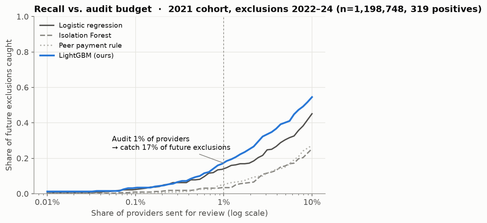
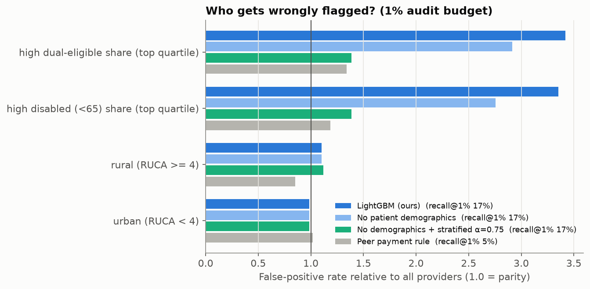

# Forecasting Medicare fraud exclusions from public billing data

[](https://github.com/benyahuta/medicare-fraud-forecasting/actions/workflows/ci.yml)

[Interactive results](https://benyahuta.github.io/medicare-fraud-forecasting/) · [Model card](MODEL_CARD.md) · [Full results tables](reports/RESULTS.md)

When the HHS Office of Inspector General (OIG) catches a provider committing Medicare fraud or abuse, it can ban
them from billing Medicare. That ban is called an exclusion, and OIG publishes the list. OIG can only look at a small
share of the ~1.2 million providers who bill Medicare, so the order it looks at them in matters.

I wanted to see two things:

1. Can a model trained only on public CMS billing data rank providers by how likely they are to be excluded in the
   next three years?
2. Does that ranking unfairly point at doctors who serve low-income or disabled patients?

For each provider and year, CMS publishes what they billed: which services, how many, to how many patients, and what
they prescribed under Part D. I turned that into 86 features, most of them "how unusual is this provider compared with
others in the same specialty that year". I trained on 2016–2019 and tested on 2021 billing against the exclusions OIG
actually made in 2022–2024. No test-period outcome is used in training.

<p align="center"></p>

## Results

The 2021 test year has 1,198,748 providers. 319 of them were excluded in 2022–24, about 1 in 3,800.

| | LightGBM (mine) | Logistic regression | Peer-payment rule¹ | Isolation Forest |
|---|---|---|---|---|
| Recall when reviewing the top 1% | 17.2% (13.3–21.3) | 14.1% | 5.0% | 3.4% |
| Lift over random at 1% | 17× | 14× | 5× | 3× |
| ROC-AUC | 0.823 (0.800–0.850) | 0.776 | 0.582 | 0.644 |
| Average precision (random = 0.0003) | 0.0028 | 0.0018 | 0.0005 | 0.0006 |

¹ Rank providers by how much more they're paid per patient than others in their specialty. This is roughly what a
spreadsheet audit would do. Numbers in parentheses are 95% bootstrap confidence intervals.

Reviewing the riskiest 1% (about 12,000 providers) finds 55 of the 319, which is 3.4× what the peer-payment rule finds
with the same effort. Those 55 were excluded a median of 26 months after the billing year the model scored, so there
is a real window to act.

Ranking by risk × Medicare dollars instead of risk alone puts 59% of the money paid to later-excluded providers into a
1% review list. That's with two very large labs left out; with them it's 88%. Ranking by dollars alone gets 35%.

The results also hold up over time. Retrained and retested for each year from 2019 to 2022, AUC stays between 0.818
and 0.825 and top-1% recall between 14.6% and 20.4%.

## Who gets wrongly flagged

At a 1% budget, the model's false positives land on providers in the top quartile of dual-eligible (low-income)
patients 3.4× as often as on the average provider. The same holds for providers with many disabled (under-65)
patients. Part of that is real: exclusions are about 1.6× more common in those groups. But false-positive rate is
measured only on providers who were never excluded, so this is extra scrutiny of honest clinics.

Removing the patient-demographic features only gets it to 2.9×, because billing patterns act as proxies. What
worked was also ranking providers within patient-mix groups and blending that with the overall ranking, controlled by
a weight α. With demographics removed and α = 0.75, the worst-group ratio drops to 1.4× and recall stays at 16.9%.
Full parity (α = 1) gets to 1.13× at 14.7% recall. I read these α values off the test set, so anyone using this should
pick α on their own validation data.

<p align="center"></p>

## Data and setup

| Cohort | Feature year | Label window | Providers | Positives |
|---|---|---|---|---|
| train | 2016 | 2017–2019 | 1,053,934 | 309 |
| train | 2017 | 2018–2020 | 1,088,666 | 261 |
| valid | 2019 | 2020–2021 (2 yr) | 1,155,862 | 105 |
| test | 2021 | 2022–2024 | 1,198,748 | 319 |

The data is public: CMS's Medicare Physician & Other Practitioners files (by provider, and by provider × service code),
the Part D Prescribers file, and OIG's exclusion list (LEIE), joined on NPI. That's about 25 GB of raw files and 4.5M
labeled provider-years. A provider-year counts as positive if the NPI was excluded under a fraud, abuse or misconduct
authority within three years after the feature year. Providers who were already excluded are dropped.

The features fall into eight groups: volume and markup, patient mix, peer-relative versions of the volume metrics,
per-code intensity vs. peers, E/M visit-level mix, Part D prescribing (including opioids), whether the code mix looks
like the declared specialty, and basic descriptors like specialty and rurality.

## Things I learned

- How I picked hyperparameters mattered more than which model I picked. My first try tuned on the single 2019
  validation cohort (105 positives). The "best" setting was mostly noise and did worse on test than logistic
  regression: 12.2% vs 14.1% recall at 1%. Switching to provider-grouped 3-fold CV on the training years fixed it, and
  the winner was a heavily regularized model.
- The engineered features roughly double average precision over the CMS summary file alone (0.0028 vs 0.0013). No
  single feature group is essential, though. Removing any one costs at most 7% of AP, and removing the patient-mix
  group actually raised it (0.0034), though that's within noise.
- The textbook upcoding signal (billing lots of level 4–5 office visits) is weak on its own. Excluded internists and
  family doctors sit at both extremes of the visit-level mix, not just the high end.
- I also tried a transformer over each provider's raw billing lines. Trained end to end it got AUC 0.718 and AP 0.0010.
  Its self-supervised embeddings added +0.0002 AP to LightGBM (95% CI −0.0001 to +0.0010), so not a real gain. With a
  few hundred positives, domain features win.
- The scores aren't calibrated across years. The model expected 165 exclusions in 2021 and 319 happened, so I only use
  the scores for ranking.

Details for all of this, including the per-specialty breakdown, the ablations and the rolling-year tables, are in
[reports/RESULTS.md](reports/RESULTS.md).

## Limitations

Exclusion isn't the same as fraud. The labels only cover who OIG caught, so the model learns OIG's enforcement
patterns, including any bias in them. It uses aggregate public data only, with no claims or diagnoses. There are only a
few hundred positives per year, so the confidence intervals are wide. This is meant to help someone decide where to look
first, not to accuse anyone, and the repo doesn't publish a score for any individual provider. See the
[model card](MODEL_CARD.md).

## What I'd do next

- Pick the fairness weight α on a held-out year instead of reading it off the test set
- Try claim-level data if I could get access, since that's where a sequence model might actually help
- Calibrate the scores so they can be read as probabilities
- Add a few more test years as new exclusions come out

## Running it

You need [uv](https://docs.astral.sh/uv/), about 30 GB of disk and 16 GB of RAM. On a Mac, LightGBM also needs
`brew install libomp`.

```bash
uv sync --extra deep
make data          # download the CMS and OIG files (~25 GB)
make features      # build the dataset
make experiments   # baselines, LightGBM, ablations, fairness
make rolling       # rolling test years 2019–2022
make deep          # transformer experiments
make report        # figures, RESULTS.md, site data
make test
```

Code is in `src/fraudml/`, scripts are in `scripts/`, and the outputs are in `reports/`.

## License

The code is MIT. The data is public CMS and HHS-OIG files, which aren't included in the repo (`make data` downloads
them). This is an independent project and isn't affiliated with CMS or OIG.
